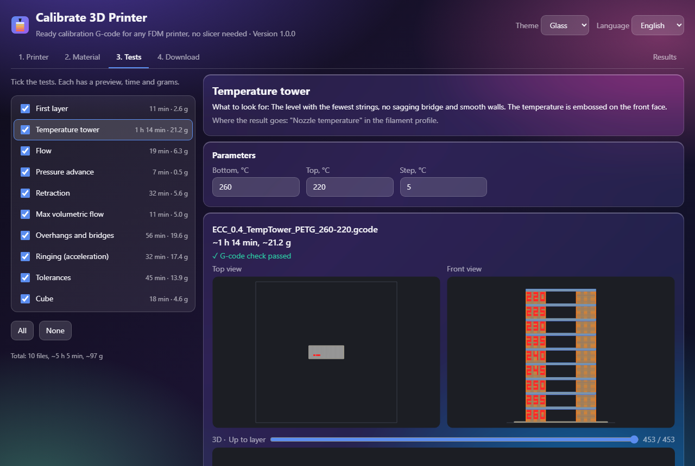
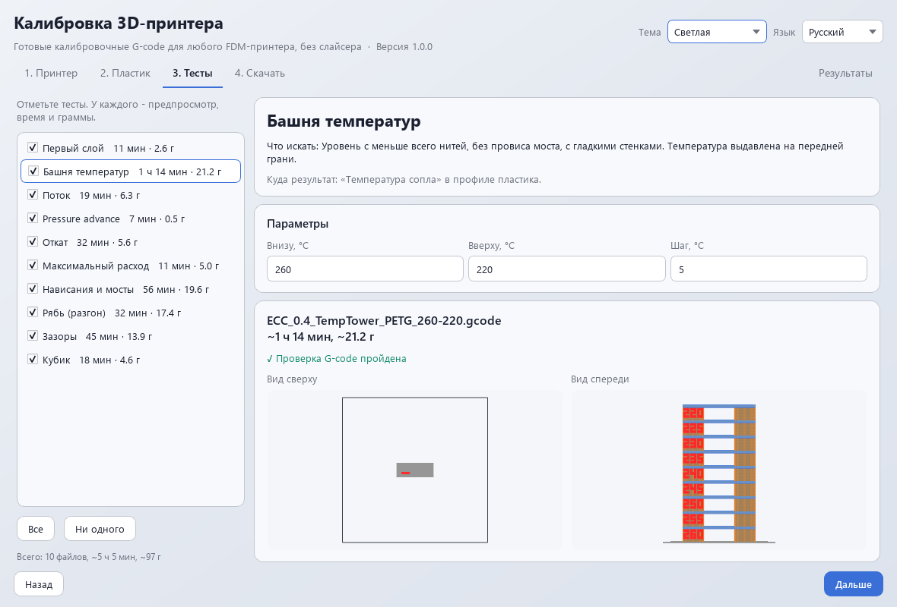

# Calibrate 3D Printer

Ready-to-print calibration G-code for any FDM printer, without a slicer: ten tests,
a preview of each, and a helper that turns "the best line" into the number for your
slicer profile. Two editions with the same core: a page (browser and Electron) and a
Python program with a Qt window. Everything runs locally, nothing is sent anywhere.

Русская версия: [README.ru.md](README.ru.md).

**Try it:** the page runs right in the browser -
[alexalesha.github.io/Calibrate3dPrinter](https://alexalesha.github.io/Calibrate3dPrinter/).
**Download** (Windows, [Releases](https://github.com/ALEXalesha/Calibrate3dPrinter/releases/latest)):
Electron edition `Calibrate3dPrinter-Electron-<version>-Setup.exe` or `-Portable.exe`;
Python edition `Calibrate3dPrinter-<version>-setup.exe` or `-portable.zip`. Changes:
[CHANGELOG.md](CHANGELOG.md).



## Where it comes from

The generator started as one Python script for an Elegoo Centauri Carbon (Klipper,
0.4 nozzle, 256 mm bed). All ten of its tests were printed on that printer and work.
That output is the reference: for the Centauri Carbon profile with default settings this
project writes **byte for byte the same G-code** as the original script, all 20 files
(10 tests x PETG/PLA). The only allowed difference is line 2, the name and version of the
program, and the test lists it explicitly (`tests/py/test_golden.py`,
`tests/js/golden.test.js`).

Everything the script kept in constants (bed, nozzle, filament, retraction, speeds,
acceleration, start and end code, firmware commands) moved into profiles. Line width and
layer height follow the nozzle: 0.45/0.5/0.2 mm at 0.4 (the reference), and 0.2, 0.6, 0.8
pass the G-code check.

## The ten tests

| # | Test | What to look for | Where the result goes |
|---|---|---|---|
| 1 | First layer | 9 squares over the bed: smooth, no gaps, no ridges | bed levelling, Z offset |
| 2 | Temperature tower | level with fewest strings, clean bridge, smooth walls | nozzle temperature |
| 3 | Flow | plate with the smoothest top | flow ratio x number/100 |
| 4 | Pressure advance | line of even width at the slow-fast steps (label 025 = 0.025) | pressure advance / K |
| 5 | Retraction | smallest retraction without strings (08 = 0.8 mm) | retraction length |
| 6 | Max volumetric flow | height where the wall turns rough; numbers are mm³/s | max volumetric speed (80-90 %) |
| 7 | Overhangs and bridges | largest clean angle, longest clean bridge | supports |
| 8 | Ringing | band where ripples start after corners | outer wall acceleration, one band lower |
| 9 | Tolerances | smallest gap where the peg comes out (15 = 0.15 mm) | clearance for moving parts |
| 10 | Cube 20 mm | X, Y, Z with calipers | flow / shrinkage / belt tension |

Max flow and ringing are printed fast on purpose: watch the first minutes.

## Your own G-code sets the printer up

The point of the project: load a G-code your printer has already printed well. The
program reads the slicer's settings block (OrcaSlicer, ElegooSlicer, Bambu Studio,
PrusaSlicer, SuperSlicer, Cura), takes the start code (everything before the first layer)
and the end code (after the last), puts placeholders in place of the temperatures it
found and lists what it replaced and what it could not find (those fields are
highlighted). Firmware comes from the header or, without one, from the commands
(`SET_PRESSURE_ADVANCE` - Klipper, `M572 D` - RepRapFirmware, `M900` - Marlin).

Checked on 12 real ElegooSlicer prints of a Centauri Carbon: the imported start code
matched the built-in profile command for command in all 12 (local test, the files are not
in the repository).

## Profiles

- **Elegoo Centauri Carbon** - checked on a real printer. The CANVAS feeder (`M6211`) and
  the nozzle wipe (`M729`) are options of the profile.
- **Generic Klipper / Marlin / RepRapFirmware**, **Generic delta** (round bed, origin in the
  centre) - minimal start code: home, heat, purge line.
- **Popular printers, marked "not checked"**: Bambu Lab A1/P1S/X1C, Prusa MK4/MK3S+,
  Creality Ender-3 V3/K1, Voron 2.4, Sovol SV06. Their start code is written for this
  project from the makers' and firmware documentation, not copied from slicer profiles
  (those are AGPL). Check any of them by importing your own G-code.
- Materials: PLA and PETG (the author's tested values), ABS, ASA, TPU (generic values).

Every firmware-dependent command lives in one table, `profiles/firmware.json`, with links to
the documentation. Klipper and Marlin links were checked; RepRapFirmware ones are marked
"to check".

## Two editions, one result

| | Version A | Version B |
|---|---|---|
| What | page `web/index.html`, the same files in Electron | Python 3.12+, PySide6 window |
| Core | `web/js/core/` (plain scripts, run in Node for tests) | `python/calib3d/core/` (no Qt) |
| Runs | from a file, GitHub Pages, Electron portable/setup | from source, exe (portable/setup) |

Both must give the same bytes. `tests/py/test_equality.py` sends the same cases through
both cores: the matrix 3 firmwares x 3 nozzles x 5 materials x 10 tests plus 120 random
valid settings (SHA-256 of the text, name, time, grams, the check and the preview), the
G-code check on files with injected faults, the importer on the samples and on cut and
random variants, the helper, the validation, and 20,000 numbers. On its first run the law
found a real bug: in JavaScript `M204 P{a} T{a}` (RepRapFirmware) had only the first `{a}`
replaced.

Keeping the numbers equal needed three decisions:
- `hypot` is CPython's `math.hypot` written out with exact products in both languages
  (equal to `math.hypot` on 2 million pairs);
- `(h/2)**2` of the original became `x*x`: on Windows `pow(x, 2)` differs from `x*x` in
  about 1 of 2000 cases; for the reference profile both give the same file (the golden test
  proves it), and `x*x` is the same everywhere;
- tangents of whole degrees come from a table made once by CPython; JavaScript's
  `toFixed` rounds exact halves up while Python rounds them to even, so `fixed()` in
  `num.js` corrects exactly those cases.

## G-code check

A small simulation reads every finished file back (`check.py` / `check.js`): inside the bed
with a margin, Z not above the maximum, speeds and accelerations within the profile,
extrusion positive and plausible for the line cross-section, temperatures within the
material, minimum layer time (except where speed is the subject), no bare command of
another firmware, no `{...}` left. Like the original, slowing a short layer scales only
the printing moves, so a slowed layer ends at about 90 % of the minimum; the check's bar is
70 %.

## Tests

| Layer | Count | Command |
|---|---|---|
| Python: golden, profiles, templates, scaling, check, params, import, equality, Qt window offscreen | 462 (+1 local) | `python -m pytest -q` |
| JavaScript core (node:test) | 44 | `npm test` |
| Page, headless Chromium, one worker | 18 | `npx playwright test --workers=1` |
| Electron app, invisible test window | 6 | `npm run test:app` |

Mutations (`python tools/mutate.py`, `--js`): the core is broken on purpose in a temporary
copy and the tests must go red: 36 Python and 11 JavaScript mutations, all caught. No test
opens a visible window: Qt runs offscreen, Chromium headless, Electron with
`CALIB3D_TEST=1` (hidden, unfocusable, off screen); pointer lock is stubbed.

## Run and build

```
python -m venv .venv && .venv\Scripts\pip install -r requirements-dev.txt
.venv\Scripts\python -m calib3d          (from python/, or set PYTHONPATH=python)
npm ci && npm start                       (Electron)
start web\index.html                      (the page, no install)

python tools/build_py.py                  -> dist/python: exe folder, portable zip, setup
npx electron-builder --win portable nsis  -> dist/electron
```

After editing `profiles/*.json` run `python tools/build_data.py` (the page carries the
profiles inside `web/js/core/data.js`; a test checks it is up to date).



## Planned

- A 3D view of the G-code in the Python edition too (the page has one; the Qt window shows
  the top and front views).
- Checking the "not checked" printer profiles on real printers, and the RepRapFirmware
  documentation links marked "to check".
- Builds for macOS and Linux (the page already runs there in any browser).

License: MIT.
