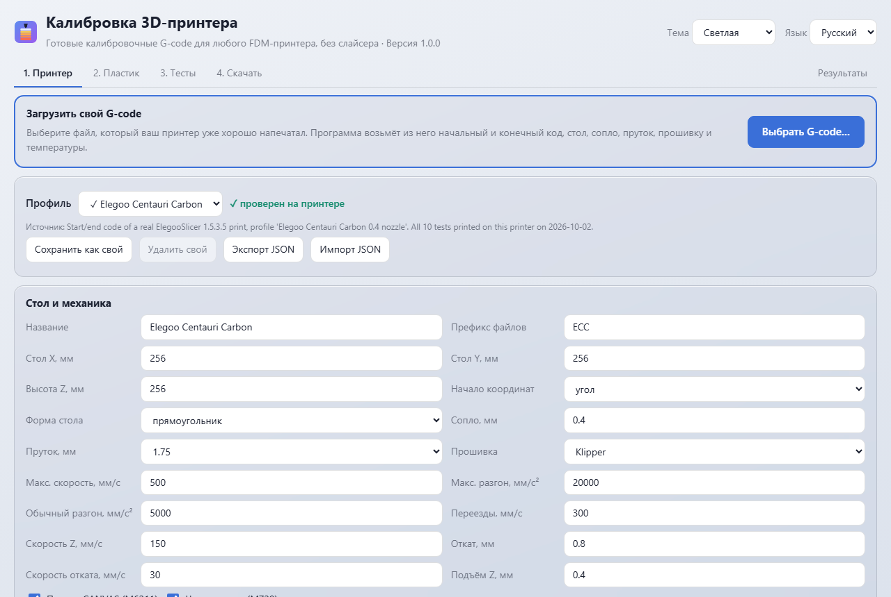
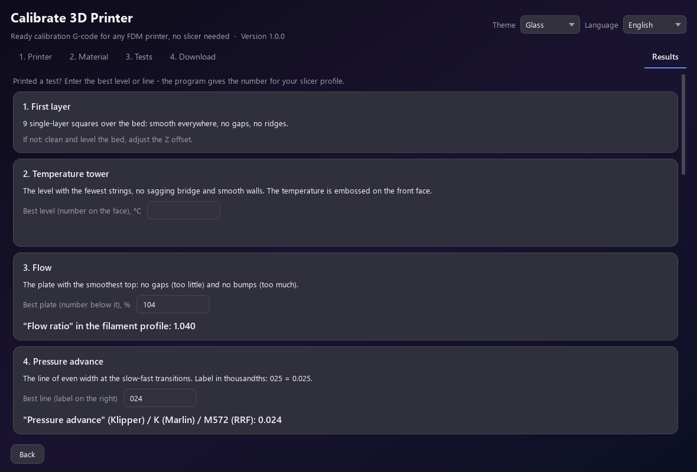

# Калибровка 3D-принтера

Готовые калибровочные G-code для любого FDM-принтера без слайсера: десять тестов,
предпросмотр каждого и помощник, который переводит «лучшую линию» в число для профиля
слайсера. Две версии с одним ядром: страница (браузер и Electron) и программа на Python с
окном на Qt. Всё считается на месте, ничего никуда не отправляется.

English: [README.md](README.md).

**Попробовать:** страница работает прямо в браузере -
[alexalesha.github.io/Calibrate3dPrinter](https://alexalesha.github.io/Calibrate3dPrinter/).
**Скачать** (Windows, [выпуски](https://github.com/ALEXalesha/Calibrate3dPrinter/releases/latest)):
версия Electron `Calibrate3dPrinter-Electron-<версия>-Setup.exe` или `-Portable.exe`;
версия Python `Calibrate3dPrinter-<версия>-setup.exe` или `-portable.zip`. Изменения:
[CHANGELOG.md](CHANGELOG.md).



## Откуда это

Генератор вырос из одного скрипта на Python для Elegoo Centauri Carbon (Klipper, сопло 0.4,
стол 256 мм). Все десять тестов скрипта напечатаны на этом принтере и работают. Его выход -
эталон: для профиля Centauri Carbon с настройками по умолчанию проект пишет **байт-в-байт
тот же G-code**, все 20 файлов (10 тестов x PETG/PLA). Разрешена одна разница - строка 2,
название и версия программы, и тест перечисляет её явно (`tests/py/test_golden.py`,
`tests/js/golden.test.js`).

Всё, что скрипт держал в константах (стол, сопло, пруток, откат, скорости, разгон,
начальный и конечный код, команды прошивки), переехало в профили. Ширина валика и высота
слоя идут от сопла: 0.45/0.5/0.2 мм при 0.4 (эталон), сопла 0.2, 0.6, 0.8 проходят проверку
G-code.

## Десять тестов

| № | Тест | Что ищем | Куда результат |
|---|---|---|---|
| 1 | Первый слой | 9 квадратов по столу: ровно, без щелей и борозд | выравнивание стола, Z-смещение |
| 2 | Башня температур | уровень с меньше всего нитей, ровный мост, гладкие стенки | температура сопла |
| 3 | Поток | плашка с самым гладким верхом | коэффициент потока x число/100 |
| 4 | Pressure advance | линия ровной толщины на переходах (подпись 025 = 0.025) | pressure advance / K |
| 5 | Откат | наименьший откат без нитей (08 = 0.8 мм) | длина отката |
| 6 | Максимальный расход | высота, где стенка стала рваной; цифры - мм³/с | макс. объёмная скорость (80-90 %) |
| 7 | Нависания и мосты | наибольший ровный угол, самый длинный ровный мост | поддержки |
| 8 | Рябь | пояс, с которого после углов появилась рябь | разгон наружных стенок - на пояс ниже |
| 9 | Зазоры | наименьший зазор, где штырь выходит (15 = 0.15 мм) | зазор для подвижных деталей |
| 10 | Кубик 20 мм | X, Y, Z штангенциркулем | поток / усадка / натяжение ремня |

Расход и рябь нарочно печатаются быстро: за первыми минутами надо следить.

## Свой G-code настраивает принтер

Главное в проекте: загрузить G-code, который ваш принтер уже хорошо напечатал. Программа
читает блок настроек слайсера (OrcaSlicer, ElegooSlicer, Bambu Studio, PrusaSlicer,
SuperSlicer, Cura), берёт начальный код (всё до первого слоя) и конечный (после последнего),
ставит подстановки вместо найденных температур и показывает, что заменила и что не нашла
(такие поля подсвечены). Прошивка - по заголовку, а без него по командам
(`SET_PRESSURE_ADVANCE` - Klipper, `M572 D` - RepRapFirmware, `M900` - Marlin).

Проверено на 12 настоящих печатях ElegooSlicer на Centauri Carbon: импортированный начальный
код у всех 12 совпал со встроенным профилем команда в команду (локальный тест, самих файлов в
репозитории нет).

## Профили

- **Elegoo Centauri Carbon** - проверен на настоящем принтере. Подача CANVAS (`M6211`) и
  чистка сопла (`M729`) - опции профиля.
- **Generic Klipper / Marlin / RepRapFirmware** и **Generic delta** (круглый стол, начало в
  центре) - минимальный начальный код: G28, нагрев, линия прочистки.
- **Популярные принтеры с пометкой «непроверено»**: Bambu Lab A1/P1S/X1C, Prusa MK4/MK3S+,
  Creality Ender-3 V3/K1, Voron 2.4, Sovol SV06. Начальный код написан для проекта по
  документации производителей и прошивок, а не скопирован из профилей слайсеров (они под
  AGPL). Любой из них стоит проверить импортом своего G-code.
- Пластики: PLA и PETG (проверенные настройки автора), ABS, ASA, TPU (общие значения).

Все команды, зависящие от прошивки, лежат в одной таблице `profiles/firmware.json` со
ссылками на документацию. Ссылки Klipper и Marlin сверены, у RepRapFirmware пометка
«проверить».

## Две версии, один результат

| | Версия A | Версия B |
|---|---|---|
| Что | страница `web/index.html`, те же файлы в Electron | Python 3.12+, окно PySide6 |
| Ядро | `web/js/core/` (обычные скрипты, в тестах идут в Node) | `python/calib3d/core/` (без Qt) |
| Запуск | из файла, GitHub Pages, Electron portable/setup | из исходников, exe (portable/setup) |

Обе версии обязаны дать одинаковые байты. `tests/py/test_equality.py` гонит одни и те же
случаи через оба ядра: матрица 3 прошивки x 3 сопла x 5 пластиков x 10 тестов и 120
случайных допустимых настроек (SHA-256 текста, имя, время, граммы, проверка и
предпросмотр), проверку G-code на файлах с внесёнными ошибками, импорт на образцах, их
обрезках и случайном тексте, помощник, проверку параметров и 20 000 чисел. На первом же
прогоне закон нашёл настоящую ошибку: в JavaScript у RepRapFirmware в `M204 P{a} T{a}`
раскрывалась только первая подстановка.

Чтобы числа совпадали, понадобилось три решения:
- `hypot` - это `math.hypot` CPython, расписанный с точными произведениями в обоих языках
  (совпадает с `math.hypot` на 2 млн пар);
- `(h/2)**2` оригинала стало `x*x`: на Windows `pow(x, 2)` отличается от `x*x` примерно в 1
  случае из 2000; для эталонного профиля оба дают тот же файл (это доказывает тест эталона),
  а `x*x` везде одинаков;
- тангенсы целых градусов - из таблицы, сделанной один раз CPython; `toFixed` в JavaScript
  округляет точные половины вверх, а Python - к чётному, поэтому `fixed()` в `num.js`
  поправляет ровно эти случаи.

## Проверка G-code

Небольшая симуляция заново читает каждый готовый файл (`check.py` / `check.js`): всё внутри
стола с запасом, Z не выше максимума, скорости и разгоны в пределах профиля, экструзия
положительная и правдоподобная по сечению валика, температуры в пределах пластика,
минимальное время слоя (кроме тестов, где скорость - предмет теста), нет «голых» команд
другой прошивки, не осталось ни одного `{...}`. Как и в оригинале, замедление короткого слоя
трогает только печатные движения, поэтому замедленный слой выходит примерно на 90 % от
минимума; планка проверки - 70 %.

## Тесты

| Слой | Сколько | Команда |
|---|---|---|
| Python: эталон, профили, шаблоны, масштаб, проверка, параметры, импорт, одинаковость, окно Qt offscreen | 462 (+1 локальный) | `python -m pytest -q` |
| Ядро на JavaScript (node:test) | 44 | `npm test` |
| Страница, headless Chromium, один поток | 18 | `npx playwright test --workers=1` |
| Приложение Electron, невидимое тестовое окно | 6 | `npm run test:app` |

Мутации (`python tools/mutate.py`, `--js`): ядро нарочно ломается во временной копии, и
тесты обязаны покраснеть: 36 мутаций Python и 11 JavaScript, все пойманы. Ни один тест не
открывает видимого окна: Qt - offscreen, Chromium - headless, Electron - с
`CALIB3D_TEST=1` (скрыто, без фокуса, за экраном); захват указателя заглушен.

## Запуск и сборка

```
python -m venv .venv && .venv\Scripts\pip install -r requirements-dev.txt
.venv\Scripts\python -m calib3d          (из python/ или с PYTHONPATH=python)
npm ci && npm start                       (Electron)
start web\index.html                      (страница, без установки)

python tools/build_py.py                  -> dist/python: папка с exe, portable zip, setup
npx electron-builder --win portable nsis  -> dist/electron
```

После правки `profiles/*.json` запустить `python tools/build_data.py` (страница несёт
профили внутри `web/js/core/data.js`; тест проверяет, что он свежий).



## В планах

- 3D-просмотр G-code и в версии Python (на странице он есть; окно Qt показывает виды сверху
  и спереди).
- Проверка профилей с пометкой «не проверено» на настоящих принтерах и ссылок на
  документацию RepRapFirmware с пометкой «проверить».
- Сборки для macOS и Linux (страница там уже работает в любом браузере).

Лицензия: MIT.
